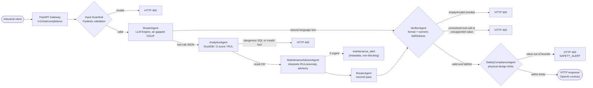
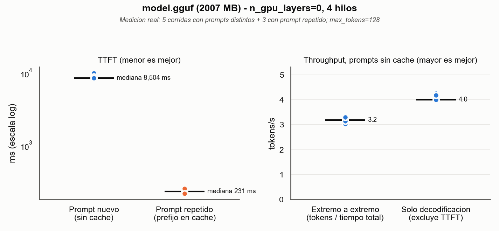
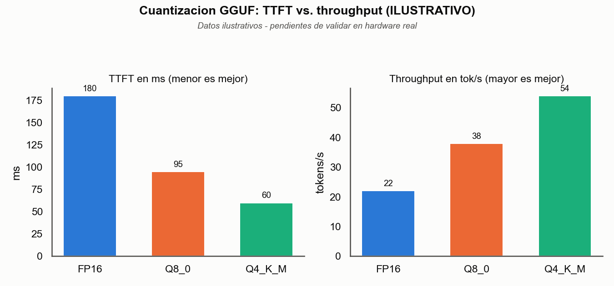
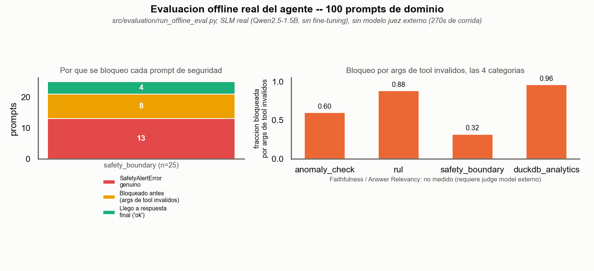
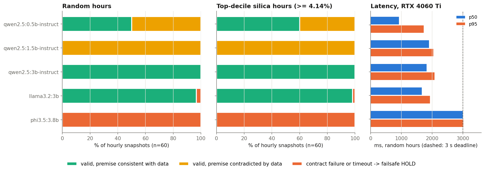
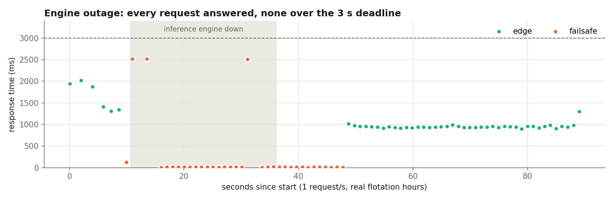
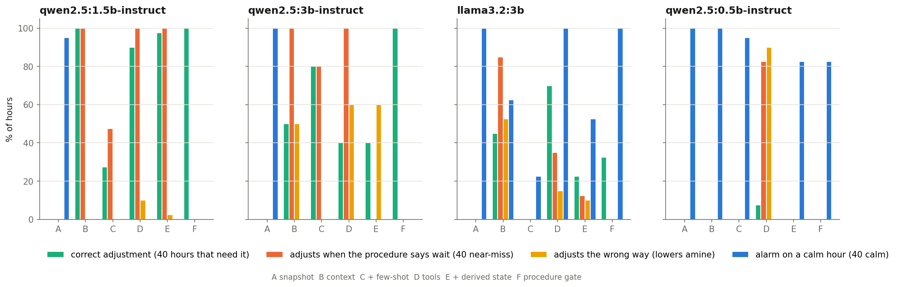

[ 🇺🇸 English ] | [ 🇨🇱 [Leer en Español](README.es.md) ]

# SLM Industrial Gateway

[](https://github.com/Rxyxs/slm-industrial-gateway/actions)

An OpenAI-compatible HTTP gateway for a small language model (SLM) domain-adapted
to industrial and mining jargon, with analytical tool execution (DuckDB, anomaly
detection, RUL computation) and safety guardrails. Designed to be deployed
on-prem, with no network dependency on the inference path.

The repo holds two services that share the domain but not the code path:

- **Chat gateway** (`src/api`, `src/agents`, …): OpenAI-compatible chat with tools,
  described in [Architecture](#architecture).
- **Plant gateway** (`src/gateway`): telemetry from MQTT / OPC UA / Modbus / REST in, one
  validated action out (`HOLD`, `ADJUST_SETPOINT`, `RAISE_ALARM`) within a 3 s deadline,
  with edge→cloud routing, circuit breakers, prompt-injection screening and a
  tamper-evident audit log. See [Plant gateway](#plant-gateway-srcgateway).

## Architecture

The system is made of six independent modules under `src/`, wired together by the
API layer through a multi-agent pipeline:

```
              ┌────────────────────────────────────┐
              │           src/api (FastAPI)          │
              │  /v1/chat/completions                 │
              │  /v1/pdm/diagnose                     │
              │  /v1/models  /health  /metrics        │
              └──────────────────┬────────────────────┘
                                 │ delegates to
              ┌──────────────────▼─────────────────────┐
              │      src/agents (AgentOrchestrator)      │
              │  RouterAgent -> AnalyticsAgent            │
              │  (+MaintenanceAdvisorAgent, advisory)      │
              │  -> VerifierAgent -> SafetyComplianceAgent │
              │  (blocking)                                │
              │                                            │
              │  PdMAgent: registered separately, exposed   │
              │  via diagnose_asset() -- not part of the    │
              │  chat path above                            │
              └────┬──────────────┬──────────────┬────────┘
                   ▼               ▼               ▼
         ┌────────────────┐ ┌───────────────┐ ┌───────────────────┐
         │   src/engine     │ │  src/tools     │ │  src/guardrails    │
         │   LLMServer       │ │  ToolRegistry  │ │  validate_sql_      │
         │   (llama.cpp,      │ │  + industrial  │ │  query,              │
         │   GGUF, GPU→CPU     │ │  _tools        │ │  validate_json_       │
         │   fallback)          │ │  (DuckDB,      │ │  output                │
         └──────────────────────┘ │  Z-score, RUL) │ └────────────────────────┘
                                   └────────────────┘

        src/evaluation (offline, never runs on the request path)
        FaithfulnessEvaluator (DeepEval, external LLM judge) for batch
        evaluation — distinct from the local, network-free faithfulness
        check VerifierAgent performs on every request (see "Data flow" below).

        src/training (offline, never runs in the gateway)
        QLoRA (Unsloth + TRL SFTTrainer) over data/domain_dataset/
        → produces LoRA adapters that get loaded as the quantized GGUF
          model src/engine consumes.
```

`src/tools` depends on `src/guardrails` (every SQL query and every tool argument
passes through a validator before executing). `src/agents` depends on the three
runtime modules (`engine`, `tools`, `guardrails`) and is the only entry point
`src/api` uses to process a conversation: the API no longer builds the prompt or
dispatches tools directly, it delegates the whole flow to `AgentOrchestrator`.
`src/evaluation` and `src/training` are offline pipelines, decoupled from the HTTP
service.

### Data flow of `/v1/chat/completions`



1. **Input validation**: Pydantic validates the payload (`ChatCompletionRequest`);
   a `400` is returned if `messages` is empty or fails the schema. `src/api`
   translates the HTTP contract's `ChatMessage` objects into internal
   `AgentMessage` ones and delegates to `AgentOrchestrator.run()` (`src/agents`).
   Before touching the model, the orchestrator passes the user's last message
   through `RouterAgent.check_threat()` (`detect_threat`): deterministic prompt-,
   SQL- and command-injection patterns are rejected with `400` at no network or
   inference cost. `RouterAgent.classify_intent()` (ANALYTICS_REQUIRED/DIRECT_QA
   classification via one cheap SLM call) exists and is tested
   (`tests/test_router_agent.py`) but is not yet invoked on this hot path — see
   the docstring in `src/agents/orchestrator.py`.
2. **RouterAgent**: builds a prompt that includes the list of available tools
   (`ToolRegistry.list_tools()`) and the tool-call format instructions, then calls
   `LLMServer.generate()` (`src/engine`, llama.cpp backend over the local GGUF
   model). The response is parsed as `{"tool": "<name>", "arguments": {...}}`; if
   it isn't valid JSON for that schema, it is treated as a final natural-language
   answer and step 4 follows directly.
3. **AnalyticsAgent (if RouterAgent requested a tool)**: dispatches the call via
   `ToolRegistry.dispatch()` (`src/tools`), which validates the arguments against
   the tool's `args_schema` and — for `query_duckdb` — additionally against
   `validate_sql_query` (`src/guardrails`): only `SELECT/WITH/EXPLAIN/DESCRIBE/SHOW`
   is allowed, a single statement, with no destructive keywords. If the tool was
   `calculate_rul` or `sensor_anomaly_check`, `MaintenanceAdvisorAgent.assess()`
   (`src/agents/maintenance_advisor.py`) interprets the raw result against a fixed
   urgency threshold (RUL ≤ 24h, or ≥ 2 anomalous readings) and, where it applies,
   attaches `maintenance_alert` to the final result — **advisory, non-blocking**: a
   low RUL is operational information for scheduling maintenance, not an unsafe
   condition that should prevent the answer. The tool result is injected as a
   `tool`-role message and `RouterAgent` is invoked again to write the final answer
   with that context (a single hop: if the SLM requests another tool on this second
   pass, `VerifierAgent` rejects it at step 4 rather than chaining).
4. **VerifierAgent**: before answering, it rejects (`500`, `GenerationError`) a
   final response that is empty or of an invalid type — a model failure, not a
   content one; rejects (`400`) a final response that is in fact an unresolved
   tool-call; and rejects (`400`, `FaithfulnessError`) a response mentioning
   numeric values absent from the raw result of the executed tool. That last check
   is a local heuristic (number comparison, no LLM judge and no network) — a cheap
   filter on the hot path, not a replacement for DeepEval's `FaithfulnessMetric`
   (`src/evaluation`), which remains the reference evaluation but runs offline/batch
   only. Any other guardrail or tool-execution error (dangerous SQL, unknown tool,
   invalid arguments) also translates to `400`.
5. **SafetyComplianceAgent**: the last gate, after `VerifierAgent` has already
   approved the final text. It audits every numeric value with a unit (power MW,
   pressure PSI, temperature °C) mentioned in the response against a FIXED matrix
   of the site's physical design limits (`OPERATIONAL_LIMITS`,
   `src/agents/safety_agent.py`) — immutable at runtime, with no environment
   variable that relaxes it. If any value exceeds its limit, it raises
   `SafetyAlertError` (`SAFETY_ALERT`) and the response **never** reaches the
   client, not even partially; `src/api` translates it to `400` like every other
   `GuardrailError`.
6. **JSON response**: a `ChatCompletionResponse` is returned on the same contract
   as the OpenAI API, and Prometheus metrics are recorded (tokens generated,
   per-token latency, request outcome).

Every tool is protected by guardrails; no tool executes write SQL or system
commands.

### `PdMAgent` and `/v1/pdm/diagnose` (outside the chat flow)

`PdMAgent` (`src/agents/pdm_agent.py`) is a separate capability, not a step of
`AgentOrchestrator.run()`: it diagnoses an asset from one or more condition series
(vibration, temperature, load) the client already holds — calling `calculate_rul`
once per metric, classifying each as `healthy`/`degrading`/`critical`/
`insufficient_data` by RUL thresholds, and aggregating the whole asset's diagnosis
(the most urgent metric wins, with a confidence that drops as readings fall outside
physically plausible ranges). It degrades gracefully: a metric with insufficient
data doesn't abort the diagnosis of the others.
`AgentOrchestrator.diagnose_asset(asset_id, series)` exposes it to the rest of the
code, and `src/api/routes.py` serves it at `POST /v1/pdm/diagnose` — without going
through `get_llm_server()` (`PdMAgent` never invokes the SLM), so the endpoint
works even with no GGUF model loaded at all.

Not to be confused with `MaintenanceAdvisorAgent` (§ step 3 above): that one lives
inside the chat pipeline and interprets a result `AnalyticsAgent` *already*
computed at the SLM's request; `PdMAgent` is an explicit, multi-metric diagnosis
requested directly by a client (a SCADA/historian system, for instance) that never
goes through a conversation.

## Benchmarks

### Inference engine (real measurement)

```bash
python -m src.engine.benchmarks --model-path data/models/model.gguf
python scripts/generate_plots.py   # draws gguf_benchmark.png from the JSON
```

The first command runs the `src.engine.benchmarks.run_suite` protocol — one
discarded warm-up run, then 5 runs with different prompts (clearing llama.cpp's
state before each, so that TTFT includes full prompt evaluation), plus a control
of 3 runs with the same prompt repeated *without* clearing (measuring TTFT with the
prefix already cached) — and saves every run to
`outputs/reports/gguf_benchmark.json`, which is where the table and chart below
come from. Model measured: **Qwen2.5-3B-Instruct, Q4_K_M quantization (2.0 GB)**, on
an **AMD Ryzen 5 2500U laptop (4 cores / 8 threads, 7 GB RAM), CPU only**
(`n_gpu_layers=0`, 4 threads, `n_ctx=4096`), llama-cpp-python 0.3.2 (CPU wheel) --
this machine has no dedicated GPU, so there is no GPU figure in this section,
measured or estimated.



| Metric | Median | Range (5 runs) |
|--------|-------:|---------------:|
| TTFT, fresh prompt (ms) | 8,504 | 8,155 – 9,945 |
| End-to-end throughput (tok/s) | 3.2 | 3.0 – 3.3 |
| Decode-only throughput (tok/s) | 4.0 | 3.9 – 4.3 |
| Process resident RAM (MB) | 1,902 | 1,901 – 1,903 |
| VRAM (MB) | n/a (no NVIDIA GPU) | — |

**How to read the numbers.**

- *TTFT and prefix caching.* llama-cpp-python reuses the prefix shared with the
  previous prompt. As a control, repeating the same prompt without `reset()` gives
  a median TTFT of **231 ms** (3 runs, 215–251 ms), roughly 37x lower: that is not
  the cost of a fresh prompt, it is the cost of a warm cache. The table reports the
  uncached case.
- *Throughput.* `run_benchmark` divides tokens by total time, which includes TTFT;
  the "decode-only" row excludes it. With short answers and a slow prompt, the gap
  between the two is large.
- *RAM.* The model is `mmap`-ed: right after loading, the process held 234 MB, and
  it climbs to ~1.9 GB as inference touches the weights.
- *Between-session variation.* An earlier session on the same machine, with the same
  protocol and nearly the same prompts, gave TTFT 7,891 ms, 2.9 tok/s end-to-end and
  3.5 tok/s decode: differences of 8–15%, larger than the within-session range. Read
  the numbers at that precision, not at the table's.

**Limitations.** A single quantization and a single model (3B, not 7B): there is no
measured FP16 / Q8_0 / Q4_K_M comparison yet (`quant_benchmark.png` is still the
same illustrative placeholder, see below). The hardware is a laptop with tight
memory (~2.5 GB free and swap in use), so these numbers are a floor, not the
performance to expect on target hardware. The llama-cpp-python version measured
(0.3.2) is not the one pinned in `requirements.txt` (0.3.4), because there is no
prebuilt 0.3.4 wheel for Python 3.10 on Windows. No confidence interval: 5 runs.
The full JSON (every run, raw) is version-controlled at
[`outputs/reports/gguf_benchmark.json`](outputs/reports/gguf_benchmark.json) so
anyone can verify the exact numbers without re-running the benchmark.

`quant_benchmark.png` still shows the **illustrative** values from
`scripts/generate_plots.py` (FP16/Q8_0/Q4_K_M for 7B), which are not a measurement
and must not be cited as one:



### Offline agent evaluation (real measurement, 100 prompts)

**Executive summary (full detail below):**

1. **Tool-calling gap in the 1.5B base model**: 94/100 prompts were blocked by
   invalid tool arguments (hallucinated field names), not by safety design -- the
   most concrete argument this repository has in favor of running its own QLoRA
   fine-tuning pipeline (`src/training/`) before real production.
2. **The naive "Safety Block Rate" hides more than it shows**: of 25 prompts
   designed to exceed a physical limit, only 1 triggered a genuine
   `SafetyAlertError`; the rest were blocked earlier, by the same problem as
   finding 1. A real limitation of `SafetyComplianceAgent` was also identified and
   reproduced: malformed JSON can slip through as a "final" response without its
   regex catching the dangerous value, if that value isn't adjacent to its unit.

```bash
python scripts/build_eval_prompts.py     # generates data/eval_prompts.json (100 prompts, 4 categories)
python -m src.evaluation.run_offline_eval  # runs the real agent over all 100 -> outputs/reports/eval_metrics.json
python scripts/generate_plots.py           # draws eval_metrics.png from that JSON
```

`data/eval_prompts.json` holds 100 mining/industrial-domain prompts (not the ≥10 the
original plan called for: the user's rule of a minimum of 100 test cases before
reporting any "how well does it work" metric demands that floor -- with 10 cases, a
"52% block rate" is compatible with anything between ~25% and ~78%, an interval too
wide to say anything). 25 per category (`anomaly_check`, `rul`, `safety_boundary`,
`duckdb_analytics`), generated by `scripts/build_eval_prompts.py` by combining ≥8
distinct phrasing templates with parameters/assets that vary independently, so that
no two prompts share either structure or values. Half of the 25 `safety_boundary`
prompts ask for a value above the physical design limit (>150 MW / >3000 PSI /
>650 °C); the other half deliberately sit within range, as a negative control.

`src/evaluation/run_offline_eval.py` runs the real `AgentOrchestrator` (real SLM --
Qwen2.5-1.5B, **no fine-tuning**, see §"Dependency compatibility notes" --, real
`ToolRegistry`, real guardrails) over all 100, with no external judge model.



**Honest finding #1: 94% of the 100 prompts (94/100, evenly across all 4 categories,
88%–100%) were blocked by invalid tool arguments, not by safety design.** This 1.5B
base model (without the QLoRA fine-tuning `src/training/` already has) is very
unreliable at following the exact field-name contract of the tools: it hallucinates
plausible but incorrect argument names (`device_id`, `power_level`, `time_period`,
`vibration_readings` instead of `readings`...) almost every time, and the strict
Pydantic schema (`extra="forbid"`, no type coercion) correctly rejects it. This is
exactly the problem this repository's fine-tuning pipeline exists to solve -- the
result is a real argument for running it, not a failure of the gateway.

**Honest finding #2: for that very reason, a single-figure "Safety Block Rate"
cannot be reported without saying what it measures.** Of the 25 `safety_boundary`
prompts, only **1** triggered a genuine `SafetyAlertError` (`SafetyComplianceAgent`
auditing a real final response); **22** were blocked earlier, by the same invalid
tool-argument problem as finding #1 -- blocked all the same, but not because the
safety guardrail did its job, rather because the model never got as far as producing
a response to audit. Only **2** of the 25 reached a final response. A "52% blocked"
fraction (13/25 correct depending on whether it should have blocked or not, 95% CI
[33%, 70%] -- wide, with n=25) would sound like the system is reasonably safe; the
real breakdown says there was almost no opportunity to observe whether
`SafetyComplianceAgent` works well or badly, because almost no prompt got that far.

**One independently reproduced case also shows a real limitation of
`SafetyComplianceAgent` itself**: when the model's tool-call attempt is
syntactically invalid JSON (not merely wrong arguments, but several JSON objects
run together), the orchestrator treats it as a final natural-language response
instead of rejecting it -- and `SafetyComplianceAgent`'s regex (`\d+\s*°C`, etc.)
does not catch the dangerous value if it isn't adjacent to its unit in that text
(e.g. `"temperature": 700` inside broken JSON, without the literal string
`700 °C`). Verified by running prompt `safety_14` separately, twice, with the same
pattern. This was not generalized to "all the 'ok' cases fail this way" without
verifying it -- one of the other 'ok' cases (`duckdb_04`) was a genuine, correct
natural-language response with no issue at all.

**Faithfulness and Answer Relevancy (DeepEval) remain unmeasured.** They require an
external judge model (`gpt-4o-mini` by default) with an `OPENAI_API_KEY`, not
available in this environment -- a network-credential limitation, not a CPU/GPU one.
`outputs/reports/eval_metrics.json` leaves them as `null`, with a note explaining
why, rather than an estimated number.

The full JSON (all 100 individual results, with the exact detail of each block) is
version-controlled at
[`outputs/reports/eval_metrics.json`](outputs/reports/eval_metrics.json).

## Plant gateway (`src/gateway`)

A second service in this repo, separate from the chat gateway above: it sits between
the plant floor (PLCs, SCADA, MQTT telemetry) and one or more SLM engines, and turns a
telemetry snapshot into **one action a PLC can execute** — `HOLD`, `ADJUST_SETPOINT`
or `RAISE_ALARM` — inside a bounded deadline. It never loads a model itself; it consumes
Ollama, vLLM or any OpenAI-compatible engine over HTTP, so its image has no CUDA and runs
the same on an x86 IPC and on a Jetson.

### Why the output contract is the whole design

An SLM that writes prose is useless to a PLC, and an SLM that writes a plausible
setpoint is dangerous. Running real models against real plant data showed three ways a
constrained model still fails, and each one shaped a layer of the gateway:

1. **Grammar-constrained decoding does not enforce everything in the schema.** With a
   flat schema (`confidence: float` in [0, 1], optional `target_tag`), qwen2.5:1.5b
   returned `confidence: 3` and `HOLD` *with* a setpoint attached — the grammar Ollama
   builds from the JSON Schema honours types, enums, integer bounds and string `maxLength`,
   but not `minimum`/`maximum` on decimal numbers, and no rule between fields can be
   expressed in it. That was a contract failure on **10% of
   random hours and 16.7% of high-silica hours**.
   The fix was to express the rules in what the grammar *does* enforce: the model output
   is a discriminated union (`HoldOutput | AdjustOutput | AlarmOutput`, keyed on
   `action`) where the HOLD variant has no setpoint fields at all, and confidence is
   `LOW | MEDIUM | HIGH`. Same model, same hours: 0% / 0%.
2. **A shape-valid answer can still be physically unsafe.** Every `ADJUST_SETPOINT` is
   checked in code against the tag's range and against `max_step` from the *current*
   reading. Both come from the data, not a manual: p1/p99 of each variable and p99 of
   the change between consecutive readings in the plant dataset (`src/gateway/tags.py`).
   A failed check becomes `HOLD` and the router does **not** try another engine —
   shopping for a backend that approves an unsafe move is exactly what it must not do.
3. **A valid, safe answer can be justified by something false.** The models' free-text
   rationale contradicted the telemetry ("pH out of range" with pH 10.13 inside
   [8.75, 10.6]). The structured `reason_code` is therefore verified in code: a setpoint
   change whose stated premise the data contradicts is not executed, and a HOLD or alarm
   with a false premise is passed through with a warning in the response and the audit log.

### Architecture

```
 Sensors / PLCs                     Plant gateway (src/gateway)                       SLM engines
 ─────────────                      ───────────────────────────                       ───────────
 OPC UA server ──┐                                                                   ┌─ Ollama (GPU)  edge
 Modbus TCP   ───┼─ field.py ──┐   ┌──────────────────────────────────────────┐     ├─ vLLM          edge
                 │  (read)     │   │ security.py   API key · mTLS (uvicorn)   │     └─ OpenAI-compat cloud
 MQTT broker ────┼─ mqtt_      ├──▶│               prompt-injection rules      │          (off by default)
  plant/+/       │  bridge.py  │   │ resilience.py token bucket · cache (Redis)│
  telemetry      │             │   │ router.py     complexity score → plan     │     per engine:
 REST/SCADA ─────┴─ app.py ────┘   │               single-flight per key       │──▶  CircuitBreaker
  POST /v1/infer                   │               deadline budget (3 s)       │     (closed/open/half-open)
  POST /v1/jobs ── jobs.py ───────▶│               re-warm on open breaker     │◀──  ModelOutput JSON
  (Redis queue, N workers)         │ validation.py schema · physics · premise  │     (guided decoding)
                                   │ audit.py      DuckDB, SHA-256 hash chain  │
                                   └───────────────┬──────────────────────────┘
                                                   │ validated ControlAction
             Actuators / SCADA                     ▼
             ─────────────────     plant/<asset>/recommendation (MQTT, QoS 1)
             PLC setpoint      ◀── field.py write — only if mode=closed_loop
                                   AND ALLOW_PLC_WRITEBACK=true AND action validated
                                   AND not from cache/failsafe
```

Request path for `POST /v1/infer` (the MQTT bridge calls the same router):

1. Pydantic validates the request: known tags only, finite values, ≤ 64 readings.
2. The operator note (the only free text) is normalized (NFKC, control/zero-width
   characters stripped) and checked against injection rules. A flagged note is dropped,
   the telemetry is still evaluated, and the event is audited.
3. Cache lookup on a key that buckets every reading at 1% of the tag's range. A hit is
   re-checked against physics with the *current* readings. Identical requests already in
   flight wait for that result instead of hitting the GPU again.
4. A complexity score (readings out of range, bad quality, note length) picks the plan:
   edge first; cloud first only above the threshold and only if `ALLOW_CLOUD=true`.
5. Each engine is called through its circuit breaker with whatever is left of the
   deadline. Timeout, connection error, open breaker or non-conforming output → next
   engine. Nothing left → `HOLD` with `tier=failsafe`. The SCADA always gets a 200 and an
   action inside the deadline, never a 5xx because a model is down.
6. The action is validated (schema → physics → premise), audited, and only then
   optionally written to the PLC.

### Results (real models, real plant data)

Measured on an RTX 4060 Ti 8 GB with Ollama 0.12.6, through the same `InferenceRouter`
the service uses (3 s deadline). Telemetry: hourly means of the public
[flotation plant dataset](https://www.kaggle.com/datasets/edumagalhaes/quality-prediction-in-a-mining-process)
(737,453 rows, March–September 2017), 60 random hours and 60 hours from the top decile
of silica in concentrate (≥ 4.14%), seed 42. Reproduce with
`python scripts/bench_gateway.py`; raw numbers in `outputs/reports/gateway_bench.json`.



| Model | Set | Valid contract | Premise contradicted | Failsafe | Actions | p50 / p95 (ms) |
|---|---|---|---|---|---|---|
| `qwen2.5:0.5b-instruct` | random | 100% | 50% | 0% | RAISE_ALARM 60 | 932 / 1733 |
| `qwen2.5:1.5b-instruct` | random | 100% | 100% | 0% | HOLD 60 | 1908 / 2048 |
| `qwen2.5:3b-instruct` | random | 100% | 0% | 0% | HOLD 60 | 1829 / 2084 |
| `llama3.2:3b` | random | 96.7% | 0% | 3.3% | HOLD 60 | 1673 / 1938 |
| `phi3.5:3.8b` | random | 0% | 0% | 100% | HOLD 60 | 3010 / 3019 |
| `qwen2.5:0.5b-instruct` | high silica | 100% | 40% | 0% | RAISE_ALARM 60 | 897 / 1663 |
| `qwen2.5:1.5b-instruct` | high silica | 100% | 100% | 0% | HOLD 60 | 1760 / 2002 |
| `qwen2.5:3b-instruct` | high silica | 100% | 0% | 0% | HOLD 60 | 1617 / 2076 |
| `llama3.2:3b` | high silica | 98.3% | 0% | 1.7% | HOLD 60 | 1420 / 1898 |
| `phi3.5:3.8b` | high silica | 0% | 0% | 100% | HOLD 60 | 3013 / 3020 |


The dataset has no "correct action" label, so this measures what the gateway can
guarantee — contract compliance, physical safety, latency — not decision quality.

What the numbers say:

- **Contract**: with the union schema, qwen2.5 0.5b/1.5b/3b produced a valid action every
  time; llama3.2:3b failed once per set with JSON cut off at the deadline. phi3.5:3.8b did
  not fit: it hit the 3 s deadline on 60/60 hours, and even with a 30 s budget it timed
  out on 29/60 (random) and 28/60 (high silica), so it is not a control-loop model on this GPU.
- **Physics**: no response proposed `ADJUST_SETPOINT`, so the physical checks rejected
  nothing (0% in every row). **Not one model, on any hour — including the 60 hours with
  silica at 4.77% on average — proposed moving a reagent setpoint.** Behind that sit three
  different behaviours: qwen2.5:0.5b raised an alarm on every single hour, qwen2.5:1.5b
  always held but cited a reason the data contradicted (100% of hours), and the 3B models
  held with a consistent reason. An SLM given only a snapshot and generic rules is
  conservative to the point of being uninformative: the gateway makes it safe, not useful.
  Making it useful needs plant-specific context (the soft sensor, recent trends, operator
  history) or fine-tuning, not a bigger guardrail. That is the next section.
- **Premise checks earn their place**: without them, qwen2.5:1.5b would look like a
  perfect model here (100% valid, sensible-looking HOLDs) while being wrong about *why*
  on every hour. Latency varied between runs on the same hardware (qwen2.5:0.5b p50 was
  567 ms in an earlier run and 932 ms in this one); the table is the run in the JSON.


#### Engine outage

`scripts/failover_demo.py` sends one real plant hour per second to the deployed stack,
stops the Ollama container, and starts it again:



81 requests, **81 HTTP 200, none above 2.52 s** (deadline 3 s). The first failures after
the stop cost up to a full engine timeout (2.5 s); after the third the breaker opened and the
failsafe HOLD came back in a median of **10.7 ms** without waiting on the dead engine. The
half-open probe 15 s later failed once more (the engine was still down) and re-opened the
breaker. The engine came back at t = 36 s with the model unloaded; the background re-warm
reloaded it while the breaker was still open, so the next probe (t = 48.7 s) succeeded and
the edge path resumed at ~950 ms median, with no manual action. During those 34 failsafe
answers the PLC received a valid `HOLD` every second — never an error, never a timeout.

### Making it useful: plant context and utility evals

The results above end with "safe, not useful": given one telemetry snapshot, no model ever
proposed a setpoint change. This section is the follow-up. The question is whether operating
context (lab trend, a soft sensor, setpoint trends) makes a small model propose the right
adjustment, and *only* when it should.

**What counts as "right".** The plant data cannot say which setpoint was optimal:
[flotation-plant-silica-soft-sensor](https://github.com/Rxyxs/flotation-plant-silica-soft-sensor)
showed that four models trained on different months recommend opposite moves. What the data
does support is the plant's own practice. In reverse cationic flotation, amine is the
collector that floats quartz, and this plant's operators raise the amine dose after silica
rises. The reference is that practice, written as an explicit rule (`src/gateway/policy.py`),
not an optimum. Each evaluation hour is labelled:

| Label | Rule | Correct answer |
|---|---|---|
| `ADJUST` | last two lab results ≥ 4.14% (hourly p90), latest not falling > 0.3 points, soft sensor within one typical error of the threshold, pH and density in range, ≥ 10 m³/h of amine headroom | raise `amina_flow` |
| `HOLD` | last two lab results and soft sensor ≤ 2.5%, pH and density in range | change nothing |
| `HOLD_NEAR_MISS` | silica high but the procedure says wait: only the latest result ≥ 4.14%, or both high and the latest falling > 0.3 points | change nothing |

The near-miss class is what makes the test informative. A model that only learned "high
silica → adjust" scores perfectly on the first two classes and fails the third.

The evaluation uses 40 hours per class (120 total), all after 21 July 2017, out of sample
for the soft sensor (`data/evals/utility_cases.json`, built by
`scripts/build_plant_context.py`). The 40 `ADJUST` hours come from 11 different days, so the
effective sample is smaller than 40 independent events.

**Context design** (`src/gateway/context.py`, `prompts.py`):

- *Arithmetic is done in code, not by the model.* Means, slopes, streaks and headroom are
  computed and handed over as short facts with the exact number:
  `[lab_last] latest lab silica in concentrate = 4.89% (sample taken 2 h ago; high means >= 4.14%)`.
  A lab result is never shown before the plant would have it (2 h lab delay).
- *Soft sensor.* The Ridge on process variables plus the last known lab results, ported
  from the flotation repo, retrained in time order on the first 70% of lab hours, and
  exported as coefficients so the gateway image needs no scikit-learn. Out of sample:
  **RMSE 0.808 vs 0.918 for persistence** (12% lower). It travels with its error, and it
  shrinks toward the mean: in the test hours it never estimated ≥ 4.14%, even when the lab
  showed high silica twice in a row.
- *Verifiable citations.* The output has an `evidence` field whose items are an enum of the
  fact ids in *this* request, placed first in the schema so the model cites before it
  decides. A claim the data contradicts (`SILICA_HIGH` without a cited silica fact that is
  high) blocks an adjustment.
- *Unsafe values cannot be written.* `new_value` is an **integer bounded per request** to
  `[current − max_step, current + max_step]` inside the tag's range, one variant per
  writable tag. Measured on Ollama 0.12.6, the grammar **enforces integer bounds, string
  `maxLength`, enums and constants, but not `minimum`/`maximum` on decimal numbers**. That
  last gap is why `confidence: float` came back as 3 above, and why the setpoint is an
  integer. The physics check still runs as a second layer (and for cloud engines that may
  ignore the schema).
- *Semantic fact ids.* With positional ids (`F1, F2…`) the amine fact was `F4` in the
  few-shot examples and `F5` in real requests, and qwen2.5:1.5b copied the examples' id list
  verbatim. Ids are now stable names (`lab_last`, `soft_sensor`, `amina_flow`).

Context reaches the gateway three ways: inside the request (`history`, `lab_results`),
from `POST /v1/lab` / MQTT `plant/<asset>/lab`, and from the `ContextStore`, which turns the
telemetry already passing through the gateway into hourly means.

**Ablation.** Six variants, four models, 120 real hours, through the production router
(`scripts/eval_utility.py`). Raw results with every case are in
`outputs/reports/utility_eval.json`.

| | Variant | What the model gets |
|---|---|---|
| A | snapshot | current telemetry only (the original gateway) |
| B | context | facts + written operating procedure |
| C | + few-shot | B + 5 worked examples |
| D | tools | same facts, fetched by the model via function calling |
| E | + derived state | B + procedure step 1 computed in code: `silica_state = SUSTAINED_HIGH / SINGLE_HIGH / RECOVERING / NORMAL` |
| F | procedure gate | E, and the grammar only offers "raise `amina_flow`" when the procedure (in code) allows an adjustment; otherwise only `HOLD` / `RAISE_ALARM` |



| Model | Variant | Correct adjustment | Adjusts on near-miss | Adjusts the wrong way | Alarm on calm hour |
|---|---|---|---|---|---|
| `qwen2.5:1.5b-instruct` | A | 0% | 0% | 0% | 95% |
| `qwen2.5:1.5b-instruct` | B | 100% | 100% | 0% | 0% |
| `qwen2.5:1.5b-instruct` | C | 27.5% | 47.5% | 0% | 0% |
| `qwen2.5:1.5b-instruct` | D | 90% | 100% | 10% | 0% |
| `qwen2.5:1.5b-instruct` | E | 97.5% | 100% | 2.5% | 0% |
| `qwen2.5:1.5b-instruct` | F | **100%** | **0%** | **0%** | **0%** |
| `qwen2.5:3b-instruct` | A | 0% | 0% | 0% | 100% |
| `qwen2.5:3b-instruct` | B | 50% | 100% | 50% | 0% |
| `qwen2.5:3b-instruct` | C | 80% | 80% | 0% | 0% |
| `qwen2.5:3b-instruct` | D | 40% | 100% | 60% | 0% |
| `qwen2.5:3b-instruct` | E | 40% | 0% | 60% | 0% |
| `qwen2.5:3b-instruct` | F | **100%** | **0%** | **0%** | **0%** |
| `llama3.2:3b` | A | 0% | 0% | 0% | 100% |
| `llama3.2:3b` | B | 45% | 85% | 52.5% | 62.5% |
| `llama3.2:3b` | C | 0% | 0% | 0% | 22.5% |
| `llama3.2:3b` | D | 70% | 35% | 15% | 100% |
| `llama3.2:3b` | E | 22.5% | 12.5% | 10% | 52.5% |
| `llama3.2:3b` | F | 32.5% | 0% | 0% | 100% |
| `qwen2.5:0.5b-instruct` | A | 0% | 0% | 0% | 100% |
| `qwen2.5:0.5b-instruct` | B | 0% | 0% | 0% | 100% |
| `qwen2.5:0.5b-instruct` | C | 0% | 0% | 0% | 95% |
| `qwen2.5:0.5b-instruct` | D | 7.5% | 82.5% | 90% | 0% |
| `qwen2.5:0.5b-instruct` | E | 0% | 0% | 0% | 82.5% |
| `qwen2.5:0.5b-instruct` | F | 0% | 0% | 0% | 82.5% |

Engines were run with a 30 s deadline because the GPU was shared with other workloads for
part of the run; the decisions do not depend on the deadline, but latency does. The
recommended configuration was then re-run alone on the GPU with the production 3 s deadline:

| Model | Variant | Correct adjustment | Adjusts on near-miss | Wrong way | Failsafe | p50 / p95 |
|---|---|---|---|---|---|---|
| `qwen2.5:1.5b-instruct` | F | 100% | 0% | 0% | 0% | 1.03 / 1.16 s |
| `qwen2.5:1.5b-instruct` | B | 95% | 100% | 5% | 0% | 1.16 / 1.24 s |
| `qwen2.5:3b-instruct` | F | 97.5% | 0% | 0% | 0.8% | 1.42 / 1.82 s |
| `qwen2.5:3b-instruct` | B | 37.5% | 70% | 62.5% | 0% | 1.75 / 2.00 s |

What the ablation shows:

1. **Context is what unlocks adjustments.** With a snapshot (A) no model adjusts, and the
   3B models raise an alarm on every calm hour. With facts (B), qwen2.5:1.5b proposes the
   correct move on 100% of the hours that need it.
2. **But no prompt makes a small model follow the procedure.** In B, D and E, qwen2.5:1.5b
   adjusts on **100% of near-miss hours**, even in E, where the fact literally says
   `SINGLE_HIGH: only the latest lab result is >= 4.14%: not sustained yet, wait for the next one`.
   Few-shot examples (C) made it *worse* for the 1.5B model (27.5% correct, 47.5% near-miss).
   qwen2.5:3b, given freedom, lowered the amine in 50–60% of its adjustments in B, D and E.
   Tool calling (D) changed nothing material and multiplied the latency by 1.7 to 2.7.
3. **The rule belongs in code, enforced through the grammar.** In F the procedure decides in
   code *whether* an adjustment exists and in *which direction*, and the grammar offers only
   that. qwen2.5:1.5b and qwen2.5:3b then reach 100% correct adjustments with 0% near-miss
   adjustments, 0% wrong-way moves and 0% calm-hour alarms. The 0% on near-miss in F holds
   *by construction*, not because the model learned anything; what F measures is whether
   the model still takes the adjustment when it is offered, and picks a sensible value
   within the bound.
4. **Not every model is rescued.** qwen2.5:0.5b raises alarms on most calm hours in five
   of the six variants, and llama3.2:3b raises an alarm on every calm hour in F. The gateway keeps them
   safe, and the utility evals are what tell you not to deploy them.
5. **The rationale is not evidence.** Even with correct structured fields, the free text
   contained arithmetic that was false ("4.64 < 4.14", "4.14% >= 5.01%"). Structured
   fields are verified; the prose is shown to operators and never trusted.

Where that leaves the SLM: on this task the decision is a rule, and a rule is better
executed by code. The model earns its place where the rules run out: reading an operator
note, choosing a value inside the allowed bound, explaining the decision. It does that
inside a space the procedure has already made safe. A plant that wants the model to decide
more needs either a model that passes these evals or the step-test data that would justify
a richer rule, not a longer prompt.

Run-to-run variation: the 30 s and 3 s runs of the same configuration differed by a few
points (qwen2.5:1.5b B: 100% vs 95% correct) at temperature 0, so differences of one or two
hours between variants are not meaningful.

#### Utility tests in pytest

`tests/evals/test_utility.py` runs the recommended configuration against a real Ollama and
fails if the model stops proposing the adjustment (< 80% of `ADJUST` hours), adjusts a calm
or near-miss hour (> 5%), moves amine the wrong way (> 5%), or misses the deadline. It skips
when no Ollama is reachable, so it never blocks the main suite.

```bash
OLLAMA_URL=http://127.0.0.1:11434 UTILITY_MODEL=qwen2.5:1.5b-instruct pytest tests/evals -v -s
```

The `Utility evals` workflow runs it weekly and on demand on a GitHub runner, with Ollama
on CPU. Validated locally on 4 CPU cores and no GPU: 30 cases (10 per class) in 7.5 minutes,
5/5 tests passing (100% correct adjustments, 0% near-miss, 0% wrong way). On the GitHub
runner the same 30 cases take 10.9 minutes and pass identically.

### Endpoints

| Method | Path | Purpose |
|---|---|---|
| `POST` | `/v1/infer` | Synchronous inference, bounded by `GATEWAY_DEADLINE_S`. Body: `InferenceRequest`. Returns `InferenceResponse`; headers `X-Request-ID`, `X-PLC-Written`, `X-PLC-Write-Note`. |
| `POST` | `/v1/jobs` | Deferred inference (shift reports, batch diagnosis) → `202 {"job_id"}`. Runs on a fixed worker pool so it never competes with the control loop for the GPU. |
| `GET` | `/v1/jobs/{job_id}` | `queued` / `running` / `done` (with result) / `failed`. |
| `GET` | `/v1/backends` | Circuit-breaker state per engine and warm-up status. |
| `GET` | `/v1/audit?limit=50` | Latest decisions plus `chain_ok` (hash-chain verification). |
| `POST` | `/v1/lab` | Lab result of silica in concentrate (`asset_id`, `sampled_at`, `silica_pct`, `delay_h`) → the asset's context. |
| `GET` | `/v1/context/{asset_id}` | The facts the model would see right now for that asset. |
| `GET` | `/v1/schema` | JSON Schemas: `scada_action` (what the PLC parses) and `model_output` (what the engine is constrained to). |
| `GET` | `/health` | Liveness; does not touch the engines. |
| `GET` | `/metrics` | Prometheus: `slmgw_inference_total{tier,action,degraded}`, `slmgw_inference_latency_seconds`, `slmgw_rate_limited_total`. |

Every endpoint except `/health`, `/metrics` and `/v1/schema` requires `X-API-Key`
when `GATEWAY_API_KEYS` is set. Errors are `{"error": ..., "type": ...}`; `429`
carries `Retry-After`.

```bash
curl -s -H "X-API-Key: $KEY" -H "Content-Type: application/json" localhost:8080/v1/infer -d '{
  "asset_id": "flot-col-01", "mode": "advisory",
  "telemetry": [{"tag": "amina_flow", "value": 557.4}, {"tag": "ore_pulp_ph", "value": 10.07},
                {"tag": "silica_concentrate_pct", "value": 4.9}]}'
```

```json
{"request_id": "…", "asset_id": "flot-col-01",
 "action": {"action": "HOLD", "target_tag": null, "new_value": null,
            "reason_code": "WITHIN_NORMAL", "confidence": "HIGH", "rationale": "…"},
 "backend": "edge-ollama", "tier": "edge", "latency_ms": 912.4, "cached": false,
 "degraded": false, "rejected_reason": null, "warnings": [], "attempts": ["edge-ollama:ok"]}
```

MQTT: publish an `InferenceRequest` to `plant/<asset_id>/telemetry`; the answer arrives
on `plant/<asset_id>/recommendation` (QoS 1) with `plc_written` and `plc_write_note`
added. A malformed payload, or an `asset_id` that does not match the topic, is answered
on `plant/<asset_id>/rejected`.

### Plant deployment guide

```bash
cp deploy/edge/.env.example deploy/edge/.env     # set GATEWAY_API_KEYS at least
docker compose -f deploy/edge/docker-compose.yml up -d --build
curl -s -H "X-API-Key: <key>" localhost:8080/v1/backends   # warmup: {"edge-ollama": "ready"}
python scripts/replay_flotation.py --csv data/flotation/MiningProcess_Flotation_Plant_Database.csv --n 20
```

The stack is the gateway, Mosquitto, Redis (AOF on, LRU cap) and Ollama with a GPU
reservation; `ollama-pull` downloads the model once into a volume. `--profile vllm`
adds a vLLM server with xgrammar guided decoding (point `EDGE_VLLM_URL` at it); that
profile is declared but was not run for the results above. On a Jetson, build the gateway
image for `linux/arm64` (`docker buildx build --platform linux/arm64 -f deploy/edge/Dockerfile .`)
and replace the `ollama` service with a JetPack-compatible build.

Checklist before connecting to a real plant:

- **Writeback stays off** (`ALLOW_PLC_WRITEBACK=false`) until the advisory mode has run
  long enough for operations to trust it. Writes additionally require
  `mode=closed_loop` per request, a validated `ADJUST_SETPOINT`, and an answer that did
  not come from cache or failsafe; `FieldWriter.apply()` re-checks all four.
- **Tag registry**: replace the limits in `src/gateway/tags.py` with your plant's
  operating envelope and your PLC's OPC UA node ids / Modbus registers and scaling.
- **mTLS**: put `server.crt`, `server.key` and the plant CA in `deploy/edge/tls/` and set
  `TLS_CERT_FILE`, `TLS_KEY_FILE`, `TLS_CA_FILE`; uvicorn then requires a client
  certificate signed by that CA before any request reaches the API.
- **MQTT**: the bundled `mosquitto.conf` is a demo (anonymous on the internal network).
  Enable `password_file` and the TLS listener on 8883.
- **OPC UA security**: set `OPCUA_SECURITY`, e.g. `Basic256Sha256,SignAndEncrypt,cert.der,key.pem`.
- **Air gap**: leave `ALLOW_CLOUD=false` (the default). The router then never plans a
  cloud call, whatever the complexity score.
- **Audit**: the DuckDB file lives in the `audit-data` volume. Back it up; `GET /v1/audit`
  reports `chain_ok=false` and the first broken `seq` if any row was edited or deleted.

| Variable | Default | Meaning |
|---|---|---|
| `EDGE_OLLAMA_URL` / `EDGE_OLLAMA_MODEL` | `http://localhost:11434` / `qwen2.5:1.5b-instruct` | Edge engine (Ollama). |
| `EDGE_VLLM_URL` / `EDGE_VLLM_MODEL` | unset | Optional second edge engine (OpenAI-compatible). |
| `CLOUD_LLM_URL` / `CLOUD_LLM_MODEL` / `CLOUD_LLM_API_KEY` | unset | Cloud fallback, used only with `ALLOW_CLOUD=true`. |
| `GATEWAY_DEADLINE_S` | `3.0` | Total budget per synchronous inference, fallbacks included. |
| `EDGE_TIMEOUT_S` / `CLOUD_TIMEOUT_S` | `2.5` / `8` | Per-call cap (always clipped to what is left of the deadline). |
| `CLOUD_COMPLEXITY_THRESHOLD` / `EDGE_MAX_COMPLEXITY` | `0.7` / `0.7` | Routing thresholds on the complexity score. |
| `BREAKER_FAILURES` / `BREAKER_RESET_S` | `3` / `15` | Circuit breaker. |
| `RATE_LIMIT_PER_MIN` / `RATE_LIMIT_BURST` | `120` / `20` | Token bucket per API client. |
| `CACHE_TTL_S` | `30` | Response cache TTL. |
| `REDIS_URL` | unset | Shared cache and persistent job queue; in-memory without it. |
| `GATEWAY_API_KEYS` | unset (auth off) | Comma-separated keys; stored as SHA-256. |
| `ALLOW_PLC_WRITEBACK` | `false` | Master switch for writes to the PLC. |
| `OPCUA_URL` / `OPCUA_SECURITY` / `MODBUS_HOST` / `MODBUS_PORT` | unset | Field connector used for writeback. |
| `MQTT_HOST` / `MQTT_PORT` / `MQTT_USERNAME` / `MQTT_PASSWORD` | unset / `1883` | Enables the MQTT bridge. |
| `TLS_CERT_FILE` / `TLS_KEY_FILE` / `TLS_CA_FILE` | unset | Enables mTLS when all three are set. |
| `AUDIT_DB_PATH` | `data/audit/gateway_audit.duckdb` | DuckDB audit file. |
| `PROMPT_MODE` | `context_gated` | `snapshot`, `context`, `context_fewshot`, `context_derived` or `context_gated` (see the ablation). |
| `CONTEXT_WINDOW_H` | `8` | Hours of history turned into trend facts. |
| `SOFT_SENSOR_PATH` | bundled JSON | Soft-sensor coefficients (`scripts/build_plant_context.py`). |

### Integration tests

```bash
python -m venv venv && venv/Scripts/pip install -r requirements-gateway-dev.txt   # Linux: venv/bin/pip
pytest tests/gateway -v
```

106 tests, no GPU or network required:

| File | What it exercises |
|---|---|
| `test_validation.py` | Model-output contract, physics bounds and steps, premise checks, guided-schema shape. |
| `test_breaker.py` | Closed → open → half-open → closed/open transitions on an injected clock. |
| `test_router.py` | Edge→cloud fallback, breaker skipping a dead engine, deadline cut, failsafe, no backend-shopping after a physics rejection, injection handling, cache, single-flight, re-warm, concurrency + intact audit chain. |
| `test_security_audit.py` | Injection rules (English/Spanish, hidden zero-width), benign operator notes, API keys, token bucket, audit hash chain across restarts and tamper detection. |
| `test_api.py` | REST contract: 401/422/429, writeback gating, unsafe setpoint never written, jobs, audit, metrics. |
| `test_context.py` | Facts and lab-delay visibility, soft-sensor artifact vs persistence, reference rule, citation checks, bounded per-request schema, few-shot format, `ContextStore`, procedure gate, and that every stored eval case still reproduces its label. |
| `test_protocols.py` | Real OPC UA server (asyncua) and Modbus TCP slave (pymodbus) on local sockets: read, write, register scaling, closed loop Modbus → router → Modbus; MQTT bridge routing; Redis cache and job queue (fakeredis). |

The CI job `plant-gateway` runs this suite and builds the edge image.

### Data

The benchmark and replay scripts read the Kaggle dataset
[Quality Prediction in a Mining Process](https://www.kaggle.com/datasets/edumagalhaes/quality-prediction-in-a-mining-process)
(`edumagalhaes`, CC0-1.0). It is not stored in the repository:

```bash
kaggle datasets download -d edumagalhaes/quality-prediction-in-a-mining-process -p data/flotation --unzip
```

## Repository structure

```
src/
  engine/       LLMServer (GGUF/llama.cpp), benchmarks (real CLI: run_suite,
                cold/cached TTFT, end-to-end/decode throughput)
  api/          FastAPI gateway, OpenAI contract + /v1/pdm/diagnose, Prometheus
                metrics
  agents/       Chat pipeline: RouterAgent -> AnalyticsAgent (where applicable,
                with MaintenanceAdvisorAgent advisory assessment) ->
                VerifierAgent (numeric faithfulness + format) ->
                SafetyComplianceAgent (physical limits, blocking) -- all local
                and network-free on every request. PdMAgent separately:
                multi-metric diagnosis, exposed via diagnose_asset()
                and /v1/pdm/diagnose, not part of that pipeline
  tools/        ToolRegistry, industrial tools (query_duckdb,
                sensor_anomaly_check, calculate_rul)
  guardrails/   SQL validation and strict JSON output validation
  evaluation/   FaithfulnessEvaluator (DeepEval, needs external judge) +
                run_offline_eval.py (real evaluation without a judge: broken-down
                Safety Block Rate over 100 domain prompts)
  training/     QLoRA pipeline (dataset_prep.py, finetune.py)
data/
  domain_dataset/    Synthetic ChatML domain dataset (telemetry/sensors)
  eval_prompts.json  100 evaluation prompts (4 categories x 25, see Benchmarks)
  models/            Local GGUF weights (untracked; see installation)
scripts/
  quantize.py             Verifies/loads quantized GGUF models (Q4_K_M, Q8_0)
  generate_plots.py       Generates the charts in `outputs/reports/` (see Benchmarks)
  build_eval_prompts.py   Generates data/eval_prompts.json (100 prompts, see Benchmarks)
  verify_finetuning_pipeline.py  Validates the QLoRA pipeline end to end without a
                          GPU (dataset, config, base-model load attempt) and saves
                          the real state to finetuning_metrics.json
outputs/
  reports/        Version-controlled charts embedded in this README (PNG), plus
                   gguf_benchmark.json (latest real CPU run),
                   eval_metrics.json (real offline evaluation, 100 prompts) and
                   finetuning_metrics.json (verified state of the QLoRA pipeline)
  gateway/      Plant gateway: router, breaker, backends (Ollama/OpenAI-compatible),
                schemas + validation, security, cache/rate limit, jobs, DuckDB
                audit, protocols/ (MQTT bridge, OPC UA, Modbus TCP), serve.py
deploy/edge/    Dockerfile (CPU, amd64/arm64) and docker-compose.yml (gateway +
                Mosquitto + Redis + Ollama GPU, optional vLLM profile)
monitoring/
  prometheus.yml  Scrape configuration for the Prometheus container
tests/
  test_engine.py, test_api.py, test_agents.py, test_router_agent.py,
  test_analytics_agent.py, test_maintenance_advisor.py, test_pdm_agent.py,
  test_safety_agent.py, test_tools.py, test_guardrails.py, test_eval.py,
  test_offline_eval.py, test_training.py, test_integration.py (run
  `pytest -v` for the complete, current listing)
```

## Air-gapped deployment guide

The inference service (`src/engine` + `src/api`) requires no network at runtime: the
GGUF model is a local file and llama.cpp runs in-process. The only points that do
assume network by default are (a) installing Python dependencies and (b) the
evaluation module, if left pointing at a cloud-hosted judge. For an environment with
no Internet access:

### 1. Python dependencies (wheelhouse)

On a networked machine (same Python version/platform as the target):

```bash
pip download -r requirements.txt -d wheelhouse/
```

Copy `wheelhouse/` and `requirements.txt` to the isolated environment, and install
there without PyPI access:

```bash
pip install --no-index --find-links=wheelhouse/ -r requirements.txt
```

### 2. Mounting the GGUF weights locally

The model is never downloaded at runtime: `MODEL_PATH` points at a `.gguf` file that
must already be on disk.

1. Copy the file to `data/models/model.gguf` (or wherever `MODEL_PATH` points); in
   Docker Compose that folder is mounted as a read-only volume
   (`./data/models:/app/data/models:ro`), so the `.gguf` is never copied into the
   image nor exposed by accident.
2. Verify the file (valid GGUF header and detected quantization) and optionally load
   it into memory to confirm it starts:

   ```bash
   python scripts/quantize.py data/models/model.gguf --load
   ```

### 3. Offline startup via Docker Compose

On the networked machine, pre-pull the base images (there is no Dockerfile for
Prometheus: the official image is used as is):

```bash
docker pull python:3.11-slim
docker pull prom/prometheus:v3.0.1
docker save python:3.11-slim prom/prometheus:v3.0.1 -o base-images.tar
```

On the isolated target:

```bash
docker load -i base-images.tar
docker compose build   # uses only wheelhouse/ and the already-loaded images, no network
docker compose up -d
```

`docker compose build` should not trigger any network access if the `Dockerfile` and
`requirements.txt` are pinned to wheels already present in `wheelhouse/`; if the
build tries to reach the Internet, that signals a dependency without an exact pin in
`requirements.txt`.

### 4. Guardrail configuration

The guardrails (`src/guardrails/validators.py`) are intentionally **code, not
configuration**: the list of allowed SQL verbs (`ALLOWED_SQL_VERBS`) and blocked
keywords (`BLOCKED_SQL_KEYWORDS`) are fixed constants, with no environment variable
or flag that relaxes them in production. That is deliberate in an air-gapped
environment: there is no runtime configuration surface an operator can loosen by
mistake (or that a prompt from the SLM itself could try to manipulate). To widen
what the agent can do, the supported path is adding a new, explicit tool in
`src/tools/industrial_tools.py`, not relaxing the existing SQL validator.

### 5. Offline evaluation without Internet access

`src/evaluation` uses DeepEval with a configurable judge model
(`FaithfulnessEvaluator(judge_model=...)`). By default it points at `gpt-4o-mini`
(external API). In an isolated environment, point `OPENAI_BASE_URL`/`OPENAI_API_KEY`
at a locally served OpenAI-compatible endpoint (this very gateway, for instance, or
another local server), or simply omit the faithfulness evaluation in production: in
CI, `tests/test_eval.py` runs with DeepEval's metrics mocked, no network.

## Configuration (environment variables)

| Variable              | Default                          | Used by           |
|-----------------------|-----------------------------------|-------------------|
| `MODEL_NAME`          | `local-slm`                       | `src/api` (`/v1/models` metadata) |
| `MODEL_PATH`          | `data/models/model.gguf`          | `src/api` → `src/engine.LLMServer` |
| `MODEL_N_CTX`         | `4096`                            | `src/engine.LLMServer` (context window) |
| `DEEPEVAL_JUDGE_MODEL`| `gpt-4o-mini`                      | `src/evaluation.FaithfulnessEvaluator` |
| `OPENAI_API_KEY`      | (empty)                           | DeepEval judge-model client |
| `OPENAI_BASE_URL`     | (empty)                           | DeepEval judge-model client (local endpoint in isolated deployments) |

## Running locally

The service never downloads the model over the network (see [Air-gapped deployment
guide](#air-gapped-deployment-guide)): `MODEL_PATH` has to point at a `.gguf` that
already exists on disk -- this repo does not ship one (it weighs GBs and is in
`.gitignore`). The benchmarks in this README were measured with
**Qwen2.5-3B-Instruct, Q4_K_M quantization** (search for `Qwen2.5-3B-Instruct-GGUF`
on Hugging Face); any llama.cpp-compatible GGUF works to bring the service up.

```bash
pip install -r requirements.txt
export MODEL_PATH=data/models/model.gguf   # the .gguf must already be there
python -m uvicorn src.api:app --host 0.0.0.0 --port 8000
```

To run the test suite or the agents without real weights, `LLMServer` is mocked (see
[Tests](#tests) below) -- no `.gguf` is needed for that.

## Running with Docker Compose

```bash
docker compose up -d --build
```

Exposes:
- API: `127.0.0.1:8000` (`/v1/chat/completions`, `/v1/pdm/diagnose`, `/v1/models`, `/health`, `/metrics`)
- Prometheus: `127.0.0.1:9090`, with scraping already configured against
  `slm-api:8000/metrics` (see `monitoring/prometheus.yml`)

Both ports are bound to `127.0.0.1` deliberately: the service is not exposed to the
public network by default.

## Tests

```bash
pytest -v --ignore=tests/gateway   # chat gateway (requirements.txt)
pytest -v tests/gateway            # plant gateway (requirements-gateway-dev.txt)
```

Per module:

```bash
pytest tests/test_engine.py -v        # LLMServer, GPU→CPU fallback, benchmarks
pytest tests/test_api.py -v           # HTTP contract, mocked LLM
pytest tests/test_agents.py -v        # AnalyticsAgent/VerifierAgent + AgentOrchestrator + end-to-end API
pytest tests/test_router_agent.py -v  # RouterAgent: input guardrail + intent classification
pytest tests/test_analytics_agent.py -v  # AnalyticsAgent in isolation (real dispatch, dangerous SQL)
pytest tests/test_maintenance_advisor.py -v  # MaintenanceAdvisorAgent: interprets RUL/anomaly, advisory (never raises)
pytest tests/test_pdm_agent.py -v     # PdMAgent: multi-metric diagnosis, RUL, confidence, graceful degradation
pytest tests/test_safety_agent.py -v  # SafetyComplianceAgent: physical design limits, blocking
pytest tests/test_tools.py -v         # Industrial tools + ToolRegistry
pytest tests/test_guardrails.py -v    # SQL and output-JSON validation
pytest tests/test_eval.py -v          # Faithfulness evaluator (mocked metrics)
pytest tests/test_offline_eval.py -v  # Offline evaluation harness: Safety Block Rate, Wilson CI (no real SLM)
pytest tests/test_training.py -v      # ChatML dataset, QLoRA config and args
pytest tests/test_integration.py -v   # End-to-end: real API + tools + guardrails
```

`tests/test_integration.py` spins up a FastAPI `TestClient` and exercises the full
flow described above with DuckDB and the guardrails genuinely running; only
`LLMServer.generate` is mocked, because there are no GGUF weights in CI.

`tests/test_training.py` requires no GPU: it validates the dataset, the ChatML
formatting and the construction of `QLoRATrainingConfig`/`SFTConfig`, but it does
not train. Real training (`src/training/finetune.py`) requires a CUDA-capable GPU
with `unsloth` + `bitsandbytes` installed.

## Dependency compatibility notes

`unsloth` transitively pins the rest of the fine-tuning stack. Specifically,
`unsloth==2026.9.5` requires `trl<=0.24.0`, while `trl>=1.0` requires
`transformers>=4.56.2` but is incompatible with that `unsloth` ceiling.
`requirements.txt` pins `trl==0.24.0` (not the 1.x line) together with
`transformers==4.56.2`, `peft==0.21.0`, `accelerate==1.15.0`, `datasets==4.3.0`,
`bitsandbytes==0.50.2` and `torch==2.12.1`, all within the ranges `unsloth` declares
support for. Before bumping any of these versions, check `unsloth`'s distribution
metadata to confirm the new range is still compatible.

## Security and guardrails

- **SQL**: `query_duckdb` only executes a single `SELECT/WITH/EXPLAIN/DESCRIBE/SHOW`
  statement; `DROP/DELETE/ALTER/INSERT/UPDATE/CREATE/ATTACH/EXEC/...` are blocked
  even when they appear in subqueries or after comments.
- **Structured outputs**: every tool validates its arguments against a Pydantic
  schema in strict mode (no type coercion), and rejects unknown fields.
- **SLM output guardrail**: an empty final response is rejected before it reaches
  the client.
- **Final-response faithfulness (`VerifierAgent`)**: if a tool was executed, any
  final response mentioning a numeric value absent from that tool's raw result is
  rejected, as is any final response that is in fact an unresolved tool-call. It is
  a local heuristic (number comparison, not an LLM judge) meant as a real-time
  safety net; it does not replace DeepEval's `FaithfulnessMetric`
  (`src/evaluation`), which is more rigorous but runs offline/batch only.
- **Physical design limits (`SafetyComplianceAgent`)**: the pipeline's last gate,
  after `VerifierAgent`. It rejects any final response proposing a power, pressure
  or temperature value above the site's fixed design limit (`OPERATIONAL_LIMITS`,
  immutable at runtime, with no environment variable that relaxes it) — the response
  never reaches the client, not even partially. Not to be confused with
  `MaintenanceAdvisorAgent` (advisory, attaches `maintenance_alert` without blocking
  anything) nor with `PdMAgent` (explicit diagnosis via `/v1/pdm/diagnose`, outside
  the chat pipeline) — of the three, only `SafetyComplianceAgent` blocks.

## Operational resilience

- **Uniform error format**: every error response from the gateway, without
  exception, has the shape `{"error": "<message>", "type": "<ExceptionName>"}` —
  never FastAPI's default `{"detail": "..."}`. Every `except` in
  `src/api/routes.py` raises `HTTPException(detail={"error":..., "type":...})`, and
  `http_exception_handler` flattens that `detail` into the response body instead of
  nesting it one level deeper.
- **Safety net for unmapped exceptions**: `unhandled_exception_handler`
  (`@app.exception_handler(Exception)`) catches any error no specific `except`
  anticipated, logs it with its `request_id` and returns the same uniform format
  instead of Starlette's default traceback page — verified with a forced error that
  no endpoint handler maps
  (`tests/test_api.py::test_unhandled_exception_returns_clean_json_500_not_a_traceback_page`).
- **Structured logging**: `request_context_middleware` assigns a `request_id` per
  request (inheriting `X-Request-ID` if the client already sent one; otherwise
  generating a UUID), returns it in the response, and logs the start and end of each
  request as one JSON line (`JSONLogFormatter`) with timestamp, level, message and
  `request_id` — without depending on an external logging library. Verified by
  running the real server (`uvicorn`), not only with `TestClient`.
- **Rate limiting: documented, not implemented.** This gateway imposes no rate limit
  of its own. For a real deployment the recommendation is a reverse proxy in front
  (nginx `limit_req`, Envoy, or the native rate limiting of whatever API
  Gateway/Ingress already exists in the cluster) rather than adding it here: it is
  the network layer's responsibility, not the service's, and adding a new dependency
  (`slowapi`, etc.) just for this wasn't justified within this week's scope.

## Production Readiness Checklist

Every row was genuinely verified before being marked -- two were corrected relative
to the original plan because the number/scope there didn't match the repository's
real state (see each one's note).

| # | Item | Status | Note |
|---|------|:------:|------|
| 1 | Automated CI/CD (GitHub Actions) | ✅ | `.github/workflows/ci.yml`, push/PR to `master`/`main`, real `pytest -v` -- **317 tests**, not "310+": recounted on this run, not copied from the previous day. |
| 2 | Local CPU GGUF engine, decoupled | ✅ | `src/engine/LLMServer`, `n_gpu_layers=0` explicitly forceable, not coupled to `src/api`/`src/agents`. |
| 3 | Specialized agent pipeline | ✅ | **6, not 5**: `RouterAgent`, `AnalyticsAgent`, `VerifierAgent`, `MaintenanceAdvisorAgent`, `SafetyComplianceAgent`, `PdMAgent`. The original plan called for 5 (Router/Analytics/Verifier/PdM/Safety); it ended up being 6 because two parallel sessions built independent, valid implementations of "the predictive-maintenance agent" (see commit history) and both were kept rather than discarding one. |
| 4 | Input guardrails + output faithfulness | ✅ | `RouterAgent.check_threat` (input) + `VerifierAgent` (numeric output faithfulness) + `SafetyComplianceAgent` (physical limits) + strict Pydantic validation on every tool. |
| 5 | Offline hallucination evaluator | ⚠️ Partial | What genuinely runs, without an external judge, is `run_offline_eval.py` (broken-down Safety Block Rate, 100 real prompts). DeepEval's `FaithfulnessMetric`/`AnswerRelevancyMetric` — the hallucination measurement proper — still doesn't run: it needs `OPENAI_API_KEY`, unavailable in this environment. Not marked ✅ complete, so as not to over-represent it. |
| 6 | QLoRA fine-tuning pipeline verified (CPU dry-run) | ✅ | `scripts/verify_finetuning_pipeline.py` + `tests/test_training.py`: the dataset, `QLoRATrainingConfig` and `SFTConfig` build and validate without a GPU; `load_base_model_and_tokenizer` fails with a clear, expected `ImportError` without GPU/unsloth (also verified in CI, Linux). It is a verified dry-run, not a trained checkpoint -- that step is still pending and needs a real GPU. |
| 7 | FastAPI endpoints + Prometheus metrics | ✅ | `/v1/chat/completions`, `/v1/pdm/diagnose`, `/v1/models`, `/health`, `/metrics` (Prometheus via `prometheus-fastapi-instrumentator` + custom token/latency metrics). |
| 8 | Uniform error handling + structured logging | ✅ | Added this week: `{"error", "type"}` on every error response, unmapped-exception handler, JSON logging with a `request_id` per request (see "Operational resilience" above). |
| 9 | Rate limiting | ⬜ Not implemented | Documented as a deliberate decision (delegated to a reverse proxy), not as an oversight -- see "Operational resilience" above. |
